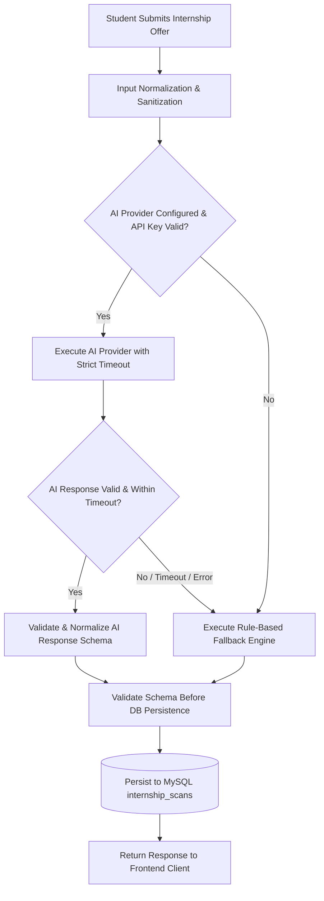

# InternShield AI - Scoring Methodology & Threat Intelligence Framework

## 1. Overview & Core Philosophy

**InternShield AI** provides automated, explainable recruitment fraud threat intelligence to protect students and job seekers from internship scams, advance fee fraud, and credential phishing syndicates.

The evaluation engine adheres to three fundamental security and ethical principles:

1. **Explainable Scoring**: Every risk score (0–100) is accompanied by an itemized mathematical breakdown detailing exactly which vectors contributed to the threat level.
2. **Facts vs. Uncertainty Distinction**: Missing information (such as an unlisted recruiter email or absent corporate website) is explicitly treated as **uncertainty**, *never* as certified proof of criminal fraud.
3. **Zero Active Execution**: Submitted URLs and domains are evaluated purely through **static syntactic heuristics**. InternShield AI **never** pings, crawls, fetches, or executes external links or binaries.
4. **Verification Boundaries**: Authenticity is only declared when an entity is cross-referenced with officially integrated corporate registries (such as the Ministry of Corporate Affairs - MCA).

---

## 2. Threat Scoring Scale & Categories

The threat score ranges from **0 to 100**, categorized into four distinct risk tiers:

| Score Range | Risk Level | Description & Operational Handling |
| :--- | :--- | :--- |
| **0 – 29** | **Low Risk** | Authentic hiring pattern, matching enterprise domain, structured technical screening or interview rounds, zero upfront fees requested. Candidate may proceed with normal caution. |
| **30 – 59** | **Medium Risk** | Moderate risk or notable uncertainty indicators (e.g. newly established domain, unverified public email provider, missing corporate website). Requires independent verification on MCA/LinkedIn. |
| **60 – 84** | **High Risk** | Multiple high-risk threat vectors detected (e.g. exclusive communication on anonymous Telegram channels, direct selection without interview, disproportionate stipend for trivial tasks). Caution strongly advised. |
| **85 – 100** | **Critical Threat** | Definite fraud mechanics present (e.g. upfront payment or deposit demanded for training/laptop, requests for bank OTPs/credentials, prepaid task recharge fraud). Candidates are advised to immediately cease all communication. |

---

## 3. The 8 Evaluated Threat Vectors

InternShield AI evaluates each submission against 8 core threat vectors:

### Vector 1: Requests for Upfront Payments (+65 points)
* **Rationale**: Authentic employers and legitimate corporate organizations **never** charge candidates for employment offers, laptop security deposits, training kits, or application processing.
* **Evaluation Criteria**: 
  * Explicit declaration (`hasUpfrontFee === 'yes'`).
  * Linguistic detection of payment demands (`pay rs`, `deposit rs`, `training fee`, `kit charge`, `refundable deposit`).
  * Recognition of explicit negative declarations (`no application fee`, `zero fee`) as positive trust signals (-5 points).

### Vector 2: Requests for Sensitive Financial Information (+45 points)
* **Rationale**: Requests for live one-time passwords (OTPs), netbanking credentials, ATM/UPI PINs, or blank signed cheques represent direct financial compromise vectors.
* **Evaluation Criteria**: Static regex analysis for banking credentials, OTP solicitations, or financial credential capture.

### Vector 3: Unrealistic Stipend Claims & Task Fraud (+30 points)
* **Rationale**: Exorbitant daily earnings (₹1,500–₹5,000/day) promised for minimal/trivial tasks (copy-paste, video likes, YouTube reviews, 1 hour/day) are the hallmark lure for prepaid task fraud and wallet recharge syndicates.
* **Evaluation Criteria**: Payout claims paired with low-skill task descriptions or demands for "recharge to unlock withdrawal".

### Vector 4: Suspicious Recruiter Email Domains (+20 to +35 pts / -15 pts)
* **Rationale**: Corporate HR recruiters use authenticated corporate domains. Free public webmail or disposable temporary mailboxes indicate unverified or evasive identity.
* **Evaluation Criteria**:
  * Disposable email domains (`mailinator.com`, `tempmail.com`): **+35 points**.
  * Free public providers (`gmail.com`, `yahoo.com`, `outlook.com`): **+20 points**.
  * Custom enterprise domain matching company website: **-15 points** (Strong Trust Signal).
  * Domain mismatch between email and corporate website: **+15 points**.
  * Recruiter email omitted: **+5 points** (Uncertainty Factor).

### Vector 5: High-Pressure Urgency Tactics (+15 points)
* **Rationale**: Artificial deadlines ("offer expires in 2 hours", "immediate joining today only", "only 2 slots left") are psychological manipulation techniques designed to prevent candidates from verifying the company.
* **Evaluation Criteria**: Lexical detection of artificial urgency and ultimatum phrases.

### Vector 6: Suspicious Application Links & Anonymous Channels (+15 to +30 points)
* **Rationale**: Directing recruitment communication exclusively through anonymous Telegram channels (`t.me`) or obfuscated URL shorteners (`bit.ly`, `tinyurl`) conceals the actor's infrastructure.
* **Evaluation Criteria** (Syntactic Only):
  * Telegram channel requirement: **+30 points**.
  * URL shorteners masking destination: **+15 points**.
  * Low-reputation/abused generic TLDs (`.xyz`, `.top`, `.buzz`, `.click`): **+15 points**.

### Vector 7: Missing Company Details (Uncertainty Factor, +8 points)
* **Rationale**: Early-stage startups may lack a web presence, but the absence of verifiable details requires independent confirmation on corporate registries.
* **Evaluation Criteria**: 
  * Missing corporate website: **+8 points**, explicitly labeled as an **Uncertainty Factor** rather than proof of fraud.
  * Verified corporate website URL provided: Positive Trust Signal.

### Vector 8: Vague Description & Lack of Technical Screening (+20 pts / -15 pts)
* **Rationale**: Authentic engineering and business internships conduct structured interview loops or technical assessments. Immediate selection with "no interview" is a high-risk mass scam indicator.
* **Evaluation Criteria**:
  * Direct selection promised without interview: **+20 points**.
  * Structured technical screening (coding test, assignment round, interview loops): **-15 points** (Trust Signal).
  * Excessively vague description (< 50 characters): **+10 points** (Uncertainty Factor).

---

## 4. Dual Provider Architecture & Fallback Protocol



1. **Primary Evaluation (Server-Side AI Provider)**:
   - Evaluates all 8 dimensions with contextual reasoning.
   - Server-side API key stored exclusively in environment variables (`GEMINI_API_KEY`).
   - Timeout race: Enforces a strict timeout (default: 8000ms) to prevent server hangs.
   - Clears event loop timer on completion.

2. **Secondary Evaluation (Rule-Based Fallback Engine)**:
   - Activated automatically if:
     - `GEMINI_API_KEY` is missing or unconfigured.
     - The AI provider call times out (> `AI_TIMEOUT_MS`).
     - The AI provider returns an HTTP error, quota exceeded (`429`), or invalid key.
     - The AI provider returns malformed or invalid JSON.
   - Deterministic mathematical evaluation of all 8 threat vectors.
   - Results are explicitly labeled: `is_fallback: true` and `provider: 'InternShield Rule-Based Threat Engine (Fallback Mode)'`.

---

## 5. Standard Ethical Intelligence Limitations

Every analysis result embeds the following mandatory limitations:

1. **Automated Threat Assessment**: Machine learning heuristics and pattern recognition do not constitute a certified legal verdict.
2. **Zero Active Execution**: Submitted URLs and domains are analyzed purely via static syntactic rules. InternShield AI does **NOT** ping, fetch, execute, or crawl external links.
3. **Uncertainty vs. Fraud**: Missing information (e.g. absent recruiter email or under-construction website) is treated as uncertainty, **NOT** definitive proof of fraud.
4. **Verification Boundary**: Authenticity is only declared when an entity is cross-referenced with officially integrated corporate registries (such as the Ministry of Corporate Affairs).

---

## 6. Output Schema Specification

```json
{
  "risk_score": 5,
  "risk_level": "Low",
  "warning_signs": [
    {
      "title": "Recruiter Domain and Website Mismatch",
      "explanation": "Recruiter email domain does not match the company website domain."
    }
  ],
  "positive_indicators": [
    "Recruiter communicates using custom enterprise domain (@microsoft.com).",
    "Application mentions structured interview loops or technical assessments."
  ],
  "explanations": "Detailed, step-by-step scoring breakdown showing each dimension evaluated...",
  "recommended_actions": [
    "Check the Ministry of Corporate Affairs (mca.gov.in) portal to confirm if the organization has an active CIN.",
    "Search for the recruiter on LinkedIn to verify their official employment tenure."
  ],
  "limitations": [
    "Automated Threat Assessment: This evaluation is generated via machine learning heuristics...",
    "Zero Active Execution: Submitted URLs and domains are analyzed purely via static syntactic rules...",
    "Uncertainty vs Fraud: Missing information is treated as uncertainty, NOT definitive proof of fraud...",
    "Verification Boundary: Authenticity is only declared when cross-referenced with official registries..."
  ],
  "questions_for_recruiter": [
    "\"Can you provide the official Corporate Identification Number (CIN) and registered office address?\""
  ],
  "is_fallback": false,
  "provider": "Google Gemini 1.5 Flash (Server-Side AI)",
  "analyzed_at": "2026-10-29T19:20:45.000Z"
}
```
